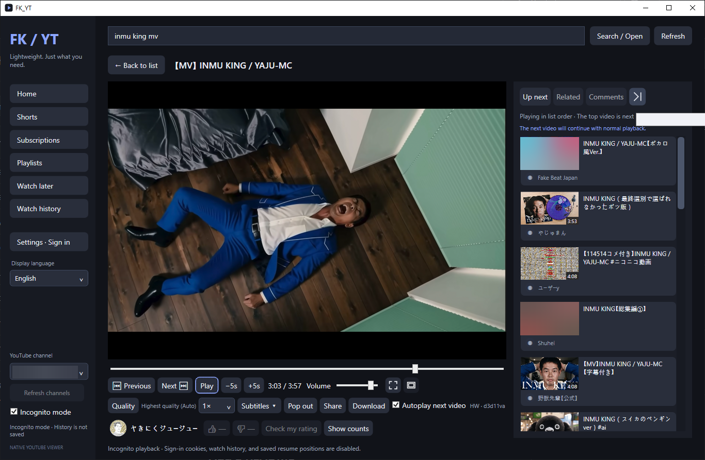
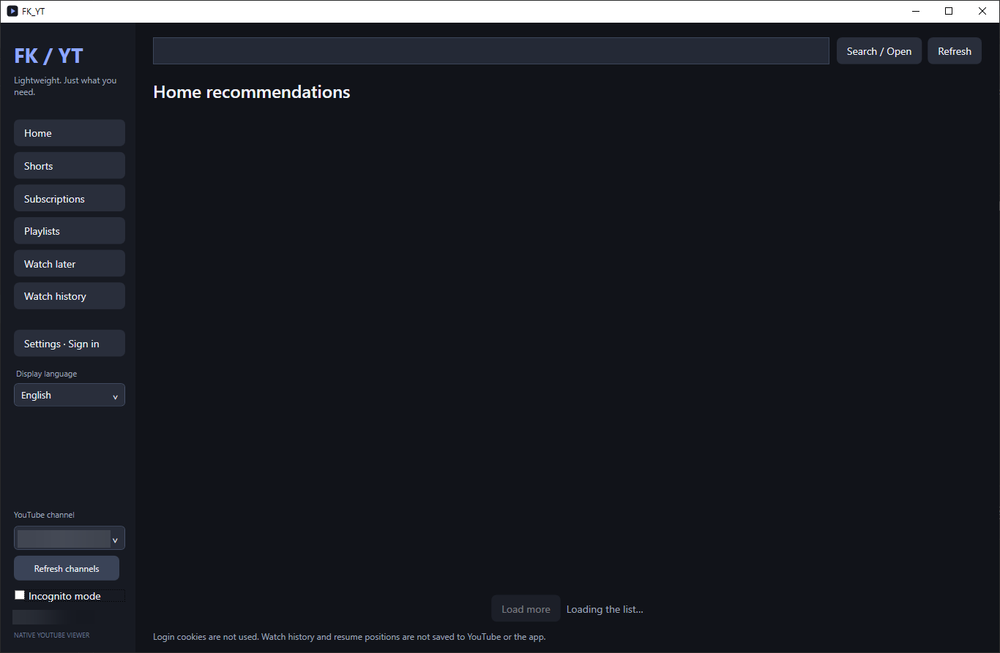
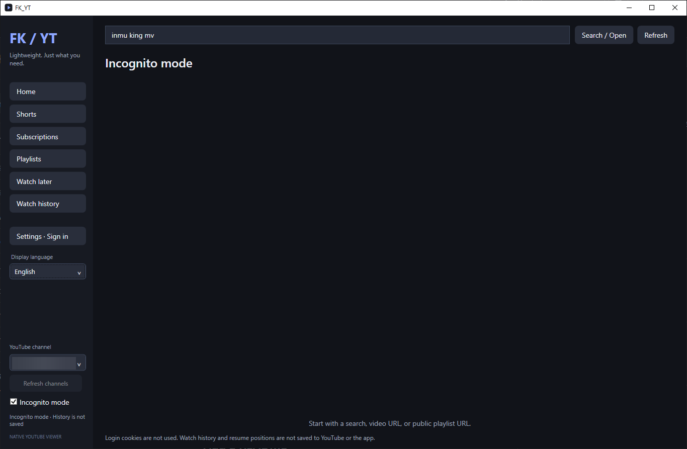
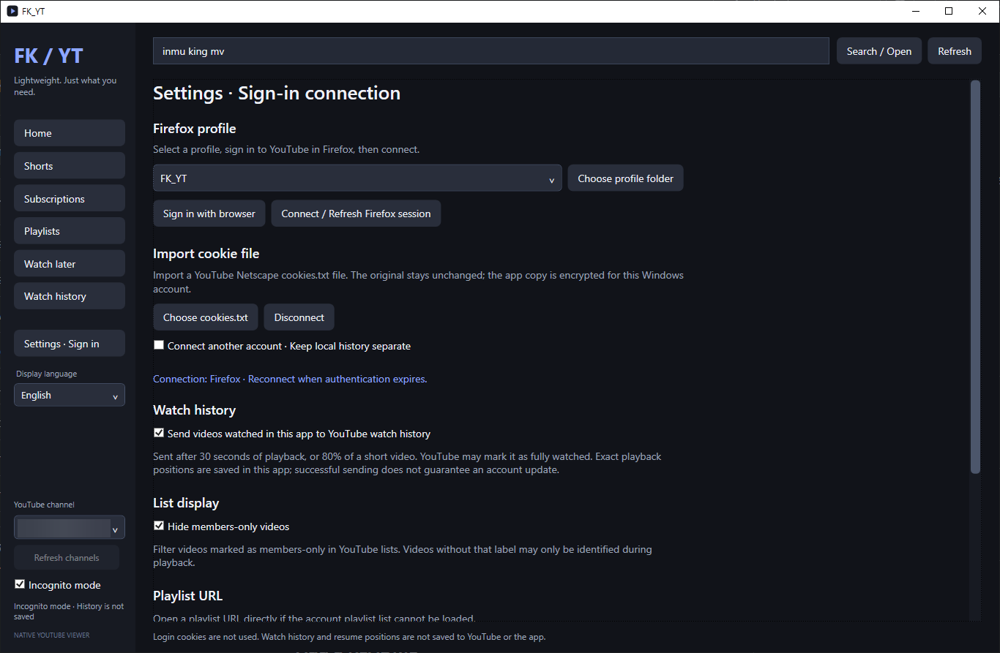

# FK_YT 1.1

**[한국어 안내](readme_KR.md)** · [English](README.md)

A personal YouTube viewer for Windows. Lists and a player, without keeping the YouTube webpage running.

**Watch, queue, and keep going.** Playback controls, quality, subtitles, and the next videos share one window. Pop the player out when you need more room.



| Home | Incognito mode | Settings and sign-in |
| :---: | :---: | :---: |
| [](assets/screenshots/home-en.png) | [](assets/screenshots/incognito-en.png) | [](assets/screenshots/settings-en.png) |
| Home screen while recommendations load. | Browse without using sign-in cookies or saving watch history and resume positions. | Connect a session and choose how watch history and members-only videos are handled. |

*Account details and selected thumbnails are blurred. Videos and artwork shown belong to their respective rights holders.*

For 1.1.2 downloads, installation and source access, see the [release guide](docs/RELEASE-1.1.2.md) and [usage and limits](docs/FEATURES-1.1.2.md). The 1.1 release and verification records below describe that earlier version.

<!-- PUBLICATION-STATUS-BEGIN -->
> **1.1 release files and verification**
> **[Release files and availability: FK_YT v1.1](https://github.com/mobsweeper/FK_YT/releases/tag/v1.1).** Compare downloads with [SHA256SUMS.txt](https://github.com/mobsweeper/FK_YT/releases/download/v1.1/SHA256SUMS.txt). Installation, installed-app launch/playback, installer updates and removal have been verified on Windows 10 and Windows 11, as confirmed by the maintainer on 2026-10-17. Installation time has not been measured. See the [files and verification scope](docs/RELEASE-1.1.md), [1.1 changes](docs/FEATURES-1.1.md), and [licensing record](docs/LICENSING-1.1.md).
<!-- PUBLICATION-STATUS-END -->

## 1. Language

[English](README.md) · [한국어](readme_KR.md)

The app interface supports English, Korean, and Japanese. Changing the interface language does not change your YouTube account's region.

## 2. What it does

FK_YT does not keep a YouTube webpage running inside the app. It uses C# WPF for the interface, Python workers and yt-dlp for the information it needs, and mpv for playback. Deno supports yt-dlp's JavaScript processing; FFmpeg handles tasks such as merging downloaded video and audio.

Browse Home, subscriptions, search, Shorts, channels, and playlists, then watch videos and read comments in the same window. Quality and subtitle selection, autoplay, a pop-out player, theater mode, and downloads are included. Availability depends on the account and what YouTube serves for each video.

The current source limits several kinds of work:

| Item | Current setting |
| --- | --- |
| Feed requests | Up to 90 entries per batch; fetch the next batch as you scroll |
| Thumbnail memory cache | 96 MiB of estimated image data |
| Thumbnail disk cache | 512 MiB, at most 8,192 entries |
| Thumbnail requests | 4 concurrent, up to 128 waiting |
| Ordinary-video mpv buffering | `cache-secs=15`, `demuxer-max-bytes=32MiB`, `demuxer-max-back-bytes=8MiB` |
| Confirmed live backward cache | 6 GiB per demuxer; forward budget stays 32 MiB; RAM only, allocated as data arrives |
| Next-video preparation | One autoplay candidate, attempted when 60 seconds or less remain |
| Comments | Up to 100, fetched when you click the comments button |
| Quality/full subtitle catalogs | Requested when you open the menu; reuse available results |

**These are individual cache and request settings, not a cap on total application RAM, GPU memory, or CPU use.** Actual usage varies with resolution, codecs, decoding, media duration, and your system. This is not a promise to beat Firefox in every workload or deliver perfectly gapless autoplay.

1.1 adds live-status handling, seeking within confirmed local live-cache ranges, and a LIVE control. Theater mode can keep comments/recommendations open, and normal/theater playback controls can be collapsed. Settings offers **manual, experimental** yt-dlp/Deno updates that take effect after restart. Shorts filtering removes explicitly marked served-ad cards; it does not promise to detect every upstream ad variant. See [1.1 features and limits](docs/FEATURES-1.1.md).

The 6 GiB live value is a backward-cache budget per demuxer, **not a whole-app RAM limit or a fixed allocation**. It cannot retrieve broadcast data from before you joined. A stream recognized as live only after loading can retain its original budget if a next-video preload was already attempted; reopening it with LIVE applies the live budget.

### Theoretical configured packet-cache budgets

These figures add the configured forward and backward budgets; they are **not strict total-RAM ceilings**. They apply to compressed media packets, not decoded frames.

| Playback/cache instance | Forward | Backward | Configured sum |
| --- | ---: | ---: | ---: |
| Current ordinary video (including its audio) | 32 MiB | 8 MiB | about 40 MiB |
| One next-video preload (including its audio) | 32 MiB | 8 MiB | up to another configured 40 MiB |
| Current ordinary video + one next-video preload | — | — | about 80 MiB combined configured budget |
| One confirmed live stream (including its audio) | 32 MiB | 6 GiB = 6,144 MiB | 6,176 MiB = 6.03125 GiB |

**Separate video/audio URLs do not normally mean two full caches in FK_YT.** Its split-stream playback path joins them into one EDL timeline; the timeline shares the packet cache, and its child demuxers do not keep another full cache. There is no fixed video-versus-audio split within that shared budget. Only genuinely independent top-level demuxers would each receive a budget, so the normal live path is not described as “6 GiB for video plus 6 GiB for audio.” See the [bundled mpv cache settings](https://github.com/mpv-player/mpv/blob/ec38361c56b2d91e417c4c3e58184535d1a1aa2e/DOCS/man/options.rst#L4279-L4324) and [timeline implementation](https://github.com/mpv-player/mpv/blob/ec38361c56b2d91e417c4c3e58184535d1a1aa2e/demux/demux_timeline.c#L614-L618).

For ordinary videos, mpv can donate unused forward space to the backward cache: 8 MiB is its baseline backward setting, not a separate hard cap; the combined budget remains 40 MiB. A preload normally has little or no played-back data, so the 80 MiB row is a conservative sum of settings, not expected initial usage. Known live playback disables this donation and next-video preloading. mpv can slightly exceed its packet-budget settings for technical reasons.

Thumbnail memory (96 MiB estimated image data), decoders, GPU textures, UI, subtitles, network buffers and packet-pool overhead are separate. For example, the listed packet budgets plus the thumbnail budget sum to about **176 MiB for current+next ordinary videos**, or **6.125 GiB for one live stream**; these partial sums still do not bound application/process RAM. Thumbnail disk cache (512 MiB) is separate from RAM, and playback disk caching is disabled. Buffers grow as data arrives rather than being fully preallocated.

## 3. Why this exists

I wanted to watch YouTube, not pay rent in RAM. Leaving it running in Firefox on my PC kept pushing memory usage up, and restarting the browser got old. So I had this made.

FK_YT's code and the words you're reading were all handed off to AI. I said "make it" and it did.

I made it for myself. After-sales service may consist of absolutely nothing.

That is the author's experience on one PC, not a finding that every Firefox installation has a memory leak. The AI statement covers FK_YT's own code and documentation; mpv, yt-dlp, and the other dependencies belong to their respective projects. Continued maintenance and fixes for future YouTube changes are not guaranteed.

## 4. Accounts and privacy

**FK_YT itself has no feature that collects usage history or sign-in information for a developer-operated server.** Playing online media still involves external services.

| Data or action | Handling |
| --- | --- |
| Settings, history, resume positions | Installed version: `%LOCALAPPDATA%\FK_YT\data` for each Windows user. Portable version: `data/` inside the extracted app folder |
| Sign-in session | Connected from a Firefox profile or Netscape cookie file. The stored app session is encrypted with Windows DPAPI for the current Windows user |
| YouTube requests | Feeds, playback, comments, and other features contact YouTube/Google and media/image CDNs. Authenticated features use the selected session |
| YouTube watch history | In normal mode, attempts to report actual playback when history synchronization is enabled. It is enabled by default |
| Likes, dislikes, recommendation feedback | Requests sent to YouTube when you choose the corresponding action |
| Return YouTube Dislike | Count queries send the video ID to the RYD API. This request path does not attach the app's YouTube sign-in cookies |
| Manual tool checks/downloads | Only when requested in Settings; official HTTPS services, without YouTube cookies |
| Build downloads | Source-build scripts contact dependency hosts and NuGet package providers |

Services you contact, including YouTube and RYD, can see ordinary connection information such as your IP address. RYD dislike counts are estimates.

Incognito mode does not use sign-in cookies or save app watch history/resume positions. It also disables account history and rating writes. **It does not hide your IP address or erase files you deliberately download.**

There are security limits. Tools may need temporary plaintext cookie files, and Firefox session extraction can create a temporary copy of the original cookie database. Encrypting stored cookies does not protect against every malicious program running as you or an already compromised PC. **Use a dedicated Firefox profile for YouTube.** Do not share or upload `data/`, cookie exports, or personal-backup ZIPs.

## 5. Requirements and versions

- Installer acceptance floor: **Windows 10 22H2, build 19045 or later, x64 (AMD64)**. Windows 11 x64 is also a target. x86 and ARM64 are not accepted. This does not mean every Windows 10 version is supported.
- Local work used **Windows 10 Pro 22H2 x64, build 19045.6456**, a PC with development tools. **The maintainer confirmed installation, installed-app launch/playback, installer updates and removal on Windows 10 and Windows 11 on 2026-10-17.** The additional Windows 11 edition/build and clean-system/standard-user conditions were not recorded; those broader environment claims are not implied.
- Installer acceptance is separate from vendor support. The tested Windows 10 Pro 22H2 system is not presented as an officially supported .NET 10 environment. Check editions and lifecycle status in the [.NET 10 supported OS table](https://github.com/dotnet/core/blob/main/release-notes/10.0/supported-os.md).
- Users **do not need to install .NET, Python, Deno, mpv, FFmpeg, or an SDK separately**. The required runtimes and tools are included in the app folder. Setup uses Windows' built-in 64-bit PowerShell.
- Account connection uses Firefox or a Netscape-format cookie file you supply. Search and some playback also work without signing in.

These are the bundled versions, preserved from the existing runtime set. **The 1.1 portable and installed versions use the same app DLL and the same application source.** The installer adds `FK_YT.install-mode` to select each Windows user's data directory. The historical [dependency lock](dependencies.lock.json) alone does not describe the final media binaries. Manually selected tool updates can differ from this table.

| Bundled component | Version / build | Purpose |
| --- | --- | --- |
| .NET / Windows Desktop Runtime | Both **10.0.13**, self-contained win-x64 | Run the WPF app |
| Python | **3.13.16**, embedded x64 | Feed/account workers |
| yt-dlp EXE / Python package | **2026.08.19 / 2026.8.19** | Extraction, metadata, downloads |
| Python inside yt-dlp EXE | **3.10.11** | Separate from the worker's Python |
| yt-dlp-ejs | **0.8.0** | JavaScript support |
| Deno | **2.9.7** | JavaScript runtime |
| mpv | **0.41.0-dev-gec38361c56-fkyt** | Playback; build prepared by FK_YT |
| FFmpeg / ffprobe | **9.0.2**, MSYS2 UCRT64 `9.0.2-1` | GPLv3-enabled shared-library build |
| Microsoft.Data.Sqlite / SQLitePCLRaw | **10.0.13 / 3.0.5** | Local database |
| Native SQLite package | **3.53.4** | Separate from Python's included SQLite |

Build-only tools are **.NET SDK 10.0.402**, **7zr 26.04** for extraction, and **NSIS 3.13** for installer creation. The SDK, compiler, and 7zr are not installed into the application folder. Setup uses NSIS **Unicode / Modern UI 2 (MUI2), English only, and zlib compression**. The NSIS x86 Unicode engine installs the x64 app payload.

## 6. Installation and launch

### For users: which file should I get?

**We recommend `FK_YT-1.1-portable.zip` for a straightforward setup.** Extract the whole archive into a new writable folder and run `FK_YT.exe` inside `FK_YT`; administrator permission is not needed there. **Both packages provide the same viewing/playback features, app DLL, and bundled runtime tools.** The installer adds machine-wide program installation, shared shortcuts, Windows removal registration, and the marker that selects per-user data. Check the release checksum for either download.

Release files and their availability are listed at [FK_YT 1.1 on GitHub Releases](https://github.com/mobsweeper/FK_YT/releases/tag/v1.1). Public release downloads do not require signing in. `Code → Download ZIP` and `FK_YT-1.1-source.zip` are developer source downloads, not ready-to-run packages.

The installer reduces duplicate integrity work: each fixed payload file receives one complete SHA-256 pass in its protected staging copy, and repeated directory-permission work is reused within each phase. Path/type/length checks and update/removal protections remain. Post-install full-file SHA checks were already absent before this change. **Actual 1.1 installation time has not been measured; no speedup percentage or completion time is claimed.**

| Detail | Installer EXE | Portable ZIP |
| --- | --- | --- |
| First launch | Approve Windows' administrator request → follow Setup's English pages → close Setup → open **FK_YT (System)** from Start Menu | Extract the **whole** ZIP into a new folder → run `FK_YT.exe` inside `FK_YT` |
| Default location | Native 64-bit `%ProgramFiles%\FK_YT`, normally `C:\Program Files\FK_YT` | A writable folder you choose |
| Administrator rights | Required for installation and removal; the app runs with normal user permissions | Not required in a writable location |
| Shortcuts | Shared Start Menu: **FK_YT (System)** and **Uninstall FK_YT (System)**; optional shared Desktop shortcut, off by default | None created automatically |
| Data | Each running Windows user's `%LOCALAPPDATA%\FK_YT\data` | `<extracted FK_YT folder>\data` |
| Removal | Windows app removal, **Uninstall FK_YT (System)**, or installed `Uninstall.exe`; profile data is preserved | Close the app and delete its folder; deleting `data` also deletes your app data |

The directory page accepts an empty app folder directly inside native 64-bit Program Files, or an existing machine installation it owns. It rejects portable folders and earlier per-user installations rather than migrating them. The installation root must be at most 100 characters long. Setup does not automatically launch the app with elevated permissions. Keep `runtime/`, `worker/`, DLLs, license notices, and the installed-mode marker intact.

**Installation itself works offline.** Setup does not download additional runtimes. YouTube browsing, streaming, comments, downloads, and RYD count queries need internet access. The app's English/Korean/Japanese selection is separate from the English installer and does not change account or region settings.

### Updates and data

- **Installed version:** Close FK_YT before running a compatible newer machine installer as administrator and selecting the existing machine installation. The implementation preserves per-user profile data and user-added files; incompatible, modified, or running installations can be refused. Installer updates were verified on Windows 10 and Windows 11 (maintainer confirmation, 2026-10-17). This does not verify the separate experimental yt-dlp/Deno updater. The application has no automatic online updater; the separate experimental tool updater is manual and applies after restart.
- **Portable version:** Close the app and keep the old folder as a backup. Extract the new ZIP into a separate empty folder, copy your preserved `data/` into the new `FK_YT/` folder, then launch it.
- **Moving from portable or an earlier per-user install:** Nothing is imported automatically. Close both apps, keep the original data, and copy it as the same Windows user into an **empty** `%LOCALAPPDATA%\FK_YT\data` after installation. Do not merge SQLite databases or overwrite a data folder already in use. Existing per-user apps, shortcuts, and data are left separate.
- Sign-in data is tied to the Windows user. Moving to a different PC or Windows account may require reconnecting the session.

### What happens when I uninstall?

Use Windows **Settings → Apps → FK_YT → Uninstall**, **Uninstall FK_YT (System)** in Start Menu, or installed `Uninstall.exe`, and approve the administrator request. The machine uninstaller is designed to remove unchanged owned program files, shared shortcuts, and machine registration. **It always preserves every user's settings, sign-in information, watch history, resume positions, and downloads; there is no user-data deletion checkbox.** It does not search other user profiles. Added, modified, or locked program-folder files may remain. Removal was verified on Windows 10 and Windows 11 (maintainer confirmation, 2026-10-17).

To delete your own installed-app data separately, close FK_YT and remove your `%LOCALAPPDATA%\FK_YT\data` only after keeping anything you need. This also removes that profile's saved sign-in and history. Downloads saved elsewhere and data in earlier portable/per-user folders are separate. If modified or added files remain in Program Files after removal, preserve them and use an empty supported folder for reinstalling.

### File verification and download commands

The installer is supplied without a publisher code signature. SmartScreen behavior after a real distribution download has not been tested, so no specific warning or wording is claimed. Use [SHA256SUMS.txt](https://github.com/mobsweeper/FK_YT/releases/download/v1.1/SHA256SUMS.txt) and the [file inventory](docs/RELEASE-1.1.md#files-and-hashes). For example, run `Get-FileHash -Algorithm SHA256 -LiteralPath '.\FK_YT-1.1-Setup-x64.exe'` in PowerShell and compare it with the release checksum. A checksum verifies matching bytes; it does not replace a code signature.

These GitHub CLI commands request the `v1.1` assets listed on the release page. Direct public release downloads also work without signing in.

```powershell
gh release view v1.1 --repo mobsweeper/FK_YT
gh release download v1.1 --repo mobsweeper/FK_YT --pattern 'FK_YT-1.1-portable.zip' --dir .\FK_YT-download
# For the installer, use this instead of the portable download:
gh release download v1.1 --repo mobsweeper/FK_YT --pattern 'FK_YT-1.1-Setup-x64.exe' --dir .\FK_YT-download
```

### For developers: repository builds and the final release differ

**`FK_YT-1.1-source.zip` contains the common product source for both portable and installed apps.** The public source excludes test projects, internal review records, and local verification outputs. Normal error handling and process cleanup are retained. The installer has its own `FK_YT-1.1-installer-source.zip`. See [build instructions](docs/BUILD-1.1.md) and [source/build boundaries](docs/RELEASE-1.1.md#source-and-build-boundaries).

Compiling the repository requires Git, **PowerShell 7**, and internet access. Cloning this public repository with Git does not require a GitHub sign-in. Ordinary users do not need to build anything.

```powershell
git clone https://github.com/mobsweeper/FK_YT.git
Set-Location FK_YT
git checkout v1.1
pwsh -NoProfile -File .\scripts\Bootstrap.ps1 -Component Dotnet
pwsh -NoProfile -File .\scripts\Build.ps1
```

This prepares a project-local SDK and builds the app; it does not prepare all external playback tools. Full `Bootstrap.ps1` and `Bootstrap-Ffmpeg.ps1` prepare **historical supplier mpv/FFmpeg builds**, so they must not be used to restore the final licensed runtime. `Publish.ps1` packages a prepared development runtime into a new self-contained directory beneath `dist/`; it does not create the final licensed package, an NSIS installer, or a GitHub release. Preserve locked hashes and investigate failures instead of disabling verification.

The [release verification scope](docs/RELEASE-1.1.md#verification-scope) distinguishes earlier preview6 checks from checks of the final 1.1 artifacts. Source publication and successful compilation do not establish actual playback, account compatibility, installation, or long-duration behavior.

Tool setup: [PowerShell](https://learn.microsoft.com/en-us/powershell/scripting/install/install-powershell-on-windows) · [Git](https://git-scm.com/install/windows) · [GitHub CLI](https://github.com/cli/cli#installation)

## 7. Basic usage

### Create a dedicated Firefox profile

Prefer a **separate profile signed in only to YouTube** over your everyday browsing profile.

1. Enter `about:profiles` in Firefox's address bar.
2. Choose **Create a New Profile** and give it a recognizable name, such as `FK_YT`. Keep the default folder unless you have a reason to change it.
3. After creating it, check that your everyday profile is still the default. Use **Set as default profile** on the old profile if necessary.
4. Under the new profile, choose **Launch profile in new browser**.
5. Sign in to YouTube in that window. Avoid adding unrelated site logins or importing your everyday profile's data into it. Mozilla account synchronization is not required.
6. In FK_YT, open **Settings · Sign-in**, select the profile, and click **Connect / Refresh Firefox session**.
7. If the profile is missing from the list, use **Choose profile folder**. Select the profile's **Root Directory** from `about:profiles`, not the Local Directory used for cache.

See [Mozilla's profile-management guide](https://support.mozilla.org/en-US/kb/profile-manager-create-remove-switch-firefox-profiles) for details. If the session expires, sign in again in that dedicated profile and refresh the connection in FK_YT.

### Browse and play

- Enter a search term or a YouTube video, channel, or playlist URL. Signing in enables account features such as personalized Home and subscriptions.
- Use **YouTube channel** in the sidebar to switch between channels belonging to the same Google account. Interface language is separate from YouTube's region setting.
- Open a video or playlist to play it. Click a channel's name or avatar to browse its videos. Channel sorting and Home categories only show choices returned by the server.
- The default quality is **Best quality (auto)**. A numeric choice sets a resolution ceiling. If a video lacks that resolution, playback selects an available quality at or below the ceiling.
- Open **Subtitles ▾** to turn subtitles off or select creator-provided, automatically generated, or translated captions. Available languages depend on the video; English, Korean, and Japanese are prioritized in the list.
- Click **Comments** to fetch them. Choose top or newest order.
- Enable next-video autoplay to continue through the queue. If preparation fails, the next item may use ordinary loading.
- **Pop out** opens a separate player window; use the return control to bring it back. Theater mode can keep comments/recommendations open. Normal/theater controls can be collapsed and restored; fullscreen and pop-out controls hide when idle. The manual collapse choice lasts for the app session.
- **Share**, or right-click a video card, to copy its video link. Use **Download** only for content you are permitted to save.
- Local resume positions and YouTube account history are separate. A successful history request does not guarantee exact cross-device position sync, and YouTube may mark a video as completed.

### Live playback and tool updates

- Live seeking uses only confirmed local mpv cache ranges, including gaps. **LIVE** reloads the broadcast edge and preserves an intentional pause. It cannot seek through the server's complete DVR window.
- Live disconnections can reconnect up to three times after 2/5/10 seconds. Authentication, access, and rate-limit errors stop retries. Automatic next-video playback waits for confirmation that the broadcast ended. Manual pause, stop, media/account changes, and incognito changes cancel recovery.
- Guest/default-slot live playback uses the existing mpv path. Other Google sign-in slots need a validated single muxed HTTPS HLS stream; unsupported selected-account transports fail explicitly without substituting another account.
- In Settings, tool checks, staging, rollback, and bundled-tool restore are manual and experimental. They apply on the **next app start**. Keep bundled tools if playback works normally. Older completed versions are retained with no automatic cleanup or total storage cap. See [tool update limits](docs/FEATURES-1.1.md#manual-experimental-tool-updates).

[English 1.1 supplementary guide](docs/guides/User-guide-1.1.txt) · [한국어 보충 안내](docs/guides/사용설명서-1.1.txt) · [日本語補足ガイド](docs/guides/ご利用ガイド-1.1.txt)

## 8. Project layout

```text
README.md              Bilingual repository landing README
readme_KR.md            Korean guide
readme_EN.md            English guide
assets/screenshots/    README screenshots with account details blurred
docs/RELEASE-1.1.md     Artifacts, hashes, source access, verification scope
docs/FEATURES-1.1.md    1.1 features and known limits
docs/BUILD-1.1.md       Compile, publish, and release assembly boundaries
src/                    C# WPF app, player, account and storage services
worker/                 Product Python workers
scripts/                Development bootstrap, build, and local Publish
dependencies.lock.json  Development tools and historical supplier runtime pins
LICENSE / license.md    MIT license and distribution guidance
```

`tools/`, `runtime/`, `dist/`, and `data/` are local build/runtime folders. Installer sources are prepared separately in `FK_YT-1.1-installer-source.zip`, not in this repository. User data and personal backups are excluded from release files.

## 9. Limitations

- **Authentication:** Expired cookies or additional authentication requirements may require reconnecting. The app does not bypass age, membership, or region restrictions. Handling an ordinary content warning does not substitute for signing in or verifying age.
- **YouTube changes:** Some features depend on unofficial extraction paths. Site changes can break feeds, playback, comments, and history reporting.
- **Subtitles:** Discovering a language does not guarantee its caption download will succeed. Requests may fail with HTTP 429, expired URLs, or unavailable captions. Not every translated language is guaranteed to load.
- **Quality and playback:** Available formats depend on the account/server, GPU and codec support, and network. Autoplay can still buffer.
- **Account behavior:** Recommendation changes, history update timing, and cross-device resume positions are not guaranteed. RYD estimates need not match YouTube's internal counts.
- **Live:** Local cache is not server DVR; live chat, scheduled-stream waiting, and recording are not included. Late recognition of a direct guest/default-slot live URL can occur after loading; earliest EOF and an old VOD resume position on that path still need separate live testing.
- **Tool updates:** Offline checks do not establish every future upstream version's compatibility or a complete Deno binary third-party-license inventory. Publisher HTTPS hashes are not an independent signature guarantee. See [the full limits](docs/FEATURES-1.1.md).
- **Support:** Environments other than Windows 10 22H2, and every DPI/GPU combination, have not been validated. Ongoing updates and fixes are not guaranteed.

For a useful bug report, include the app version, Windows version, whether incognito mode was enabled, reproduction steps, and the displayed error. Include a video URL only if you can share it. Do not attach cookies, authentication tokens, `data/`, or personal backups.

## 10. YouTube Terms of Service and account risk

FK_YT is not an official YouTube/Google app and is not endorsed by or affiliated with them. Automated requests, unofficial access, and downloads may conflict with the [YouTube Terms of Service](https://www.youtube.com/static?template=terms&hl=en), depending on how the app is used.

The app is designed to avoid unnecessary requests, but it does not guarantee YouTube approval or compliance with its terms. The likelihood of rate limiting, feature blocks, or account action has not been established. Fewer requests are **not evidence that the risk of account action is "very low."**

Review the terms and your rights to the content before use. A dedicated Firefox profile reduces the scope of cookie exposure; it is not protection against account action.

## 11. Licensing and external projects

**FK_YT's own code and documentation are distributed under the [MIT License](LICENSE).** See [license.md](license.md) for the distribution summary. External projects retain their respective licenses.

MIT it is. The author probably couldn't tell you what that means, though.

Paths below are relative to the **installed or extracted app folder**. Full component, copyright, and license information is retained in `THIRD-PARTY-NOTICES.txt`, `notices/`, and each runtime directory. This table does not replace those texts.

| Included component | License summary / notice location |
| --- | --- |
| .NET / WPF, Microsoft.Data.Sqlite | MIT plus included component and Microsoft distribution terms; `notices/dotnet/`, `notices/nuget/` |
| SQLitePCLRaw / SQLite | Apache-2.0 / public domain; `notices/nuget/` |
| Python | PSF plus historical and included-library terms; `runtime/python/LICENSE.txt`, `notices/python/` |
| yt-dlp Python package / EXE | Package: Unlicense; combined PyInstaller EXE: GPLv3-or-later. See `LICENSE`, `THIRD_PARTY_LICENSES.txt`, `SOURCE-AND-LICENSE.txt`, and `notices/` under `runtime/yt-dlp/` |
| yt-dlp-ejs / Meriyah / astring | Unlicense / ISC / MIT; original notices in `runtime/python/Lib/site-packages/yt_dlp_ejs/yt/solver/` |
| Deno and its components | MIT plus component terms; `runtime/deno/LICENSE.md`, `notices/deno/`. MPL component sources are included in `notices/deno/third-party/sources/mpl/` |
| mpv / FFmpeg and linked libraries | GPLv2-or-later mpv core combined with GPLv3-enabled FFmpeg: GPLv3-or-later distribution plus library terms. Full texts and build/source index in `notices/media/` |
| NSIS / MUI2 / zlib / plugins | Primarily zlib/libpng; original notices for the used `System`, `nsExec`, `nsDialogs`, and SystemCall MIT exception are retained. Added by the **installer only** under `notices/installer/nsis/` |

See [yt-dlp's licensing explanation](https://github.com/yt-dlp/yt-dlp#licensing) for the source/EXE distinction and the [NSIS license page](https://nsis.sourceforge.io/License) for its component terms. 7zr is a build-only tool, absent from the user distribution. RYD is an external service; its server software is not bundled.

The final mpv binary was built by FK_YT from the upstream commit with a build-identifying version-metadata change. FFmpeg is the MSYS2 UCRT64 build and its dependency cohort. These are not the historical shinchiro/Gyan binaries acquired by Bootstrap. Original and modification notices and build instructions are retained.

Corresponding source is supplied in **collections assembled by FK_YT**: `FK_YT_yt-dlp.zip`, `FK_YT_mpv-FFmpeg-part1.zip`, and `FK_YT_mpv-FFmpeg-part2.zip`. These collections are not official ZIP releases made by the upstream projects. The media files are **independent ZIPs**, not split volumes: get both and extract part1, then part2, into the **same folder**. Users do not need these source ZIPs to run the app.

The [v1.1 release page](https://github.com/mobsweeper/FK_YT/releases/tag/v1.1) lists the binary and corresponding-source assets together, without an additional source-access fee. Use that page to check availability. Keep matching source accessible alongside the binaries when redistributing. The [distribution guide](docs/RELEASE-1.1.md) lists the common app source, separate installer source, and checksums. The [licensing record](docs/LICENSING-1.1.md), [source-access map](docs/SOURCE-ACCESS-1.1.txt), and [supplemental notices](docs/LICENSES-SUPPLEMENT-1.1.txt) explain component terms, archive mappings, and remaining limits while retaining the original legal texts. The two text notices are also release assets.

The source collections' distributor metadata and broken links were repaired, and six legal-notice files were added with their provenance recorded. Four macOS-only crate archives unused by the native Windows build were excluded; upstream cross-platform locks remain intact. Unrecoverable historical URL fields are explicitly marked unknown rather than guessed. Retained upstream source/legal entries and application code/build inputs were checked unchanged.

**A complete bit-for-bit rebuild of all external binaries and recovery of the exact historical supplier librsvg lock are not complete.** Use the release page to check availability of the matching source assets. The simd_helpers notice is a labelled upstream follow-up, not a claim that its original crate contained that file. See the licensing record and distribution guide for the precise scope and remaining limits; these checks are not a legal certification.

## 12. Miscellaneous

| Item | Details |
| --- | --- |
| Writing the code | Delegated to AI |
| Writing this README | Also delegated to AI |
| Estimated debugging reviews delegated to agents | **About 195** |
| Certified bug-free | Absolutely not |

Based on **13 parallel review rounds × 15 review assignments**, checked on October 17, 2026. Repeat assignments to the same agents count; the main agent's own checks, separate external reviews, and individual follow-up questions do not. That's not 195 different AI models, and definitely not a claim of 195 bugs fixed.

*This counts static code reviews only. Dynamic checks, including actual app execution and playback, could not be tallied.*
