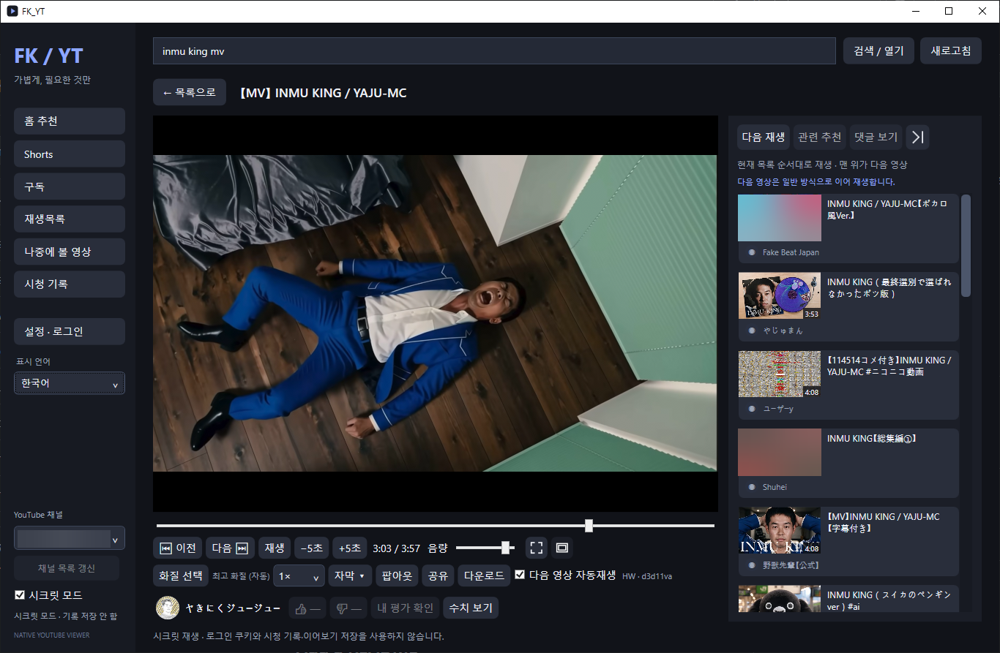
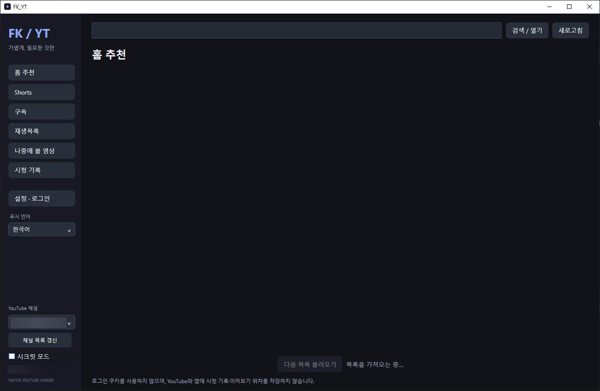
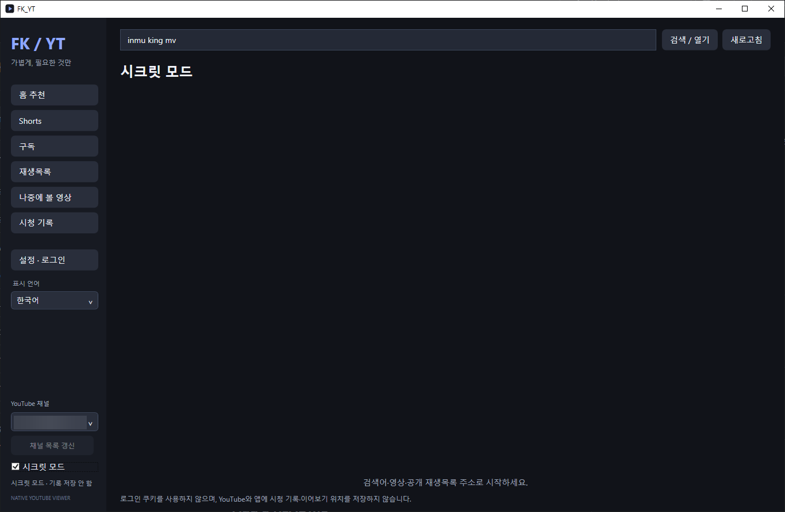
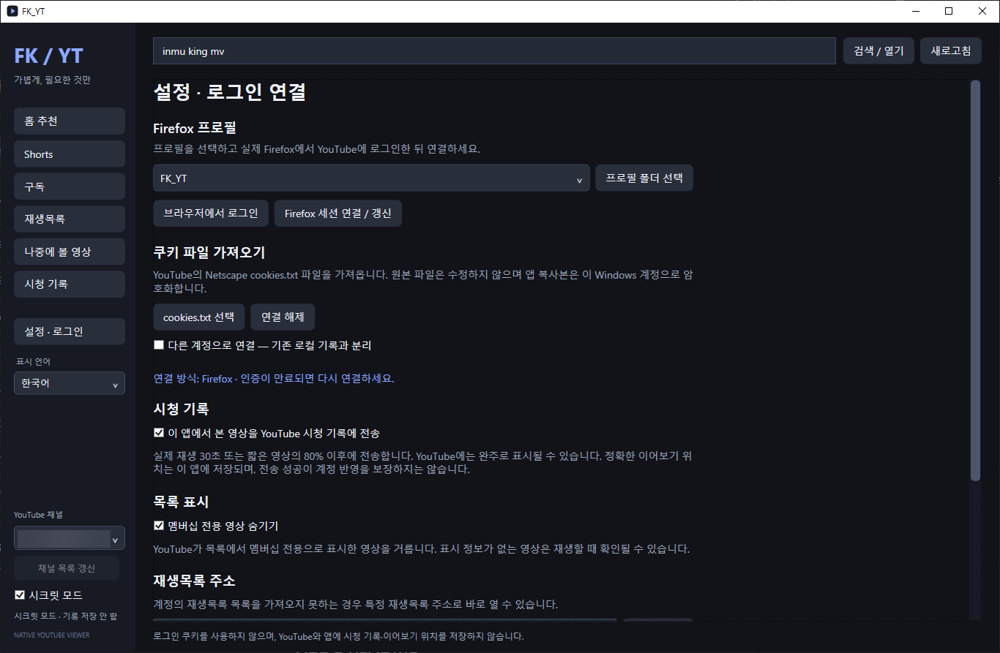

# FK_YT 1.0

Windows용 개인 YouTube 뷰어. 웹페이지 대신 필요한 목록과 플레이어만 띄웁니다.

**영상 연속재생** 재생 조작, 화질, 자막, 다음 영상 목록을 한 화면에 모았습니다. 플레이어만 따로 띄우고 싶으면 팝아웃을 누르면 됩니다.



| 홈 추천 | 시크릿 모드 | 설정·로그인 연결 |
| :---: | :---: | :---: |
| [](assets/screenshots/home-ko.png) | [](assets/screenshots/incognito-ko.png) | [](assets/screenshots/settings-ko.png) |
| 홈 추천 목록을 불러오는 화면입니다. | 로그인 쿠키를 사용하지 않고, 시청 기록과 이어보기 위치를 저장하지 않습니다. | 로그인 연결, 시청 기록 전송, 멤버십 영상 숨기기를 설정합니다. |

*계정 정보와 일부 썸네일은 가렸습니다. 화면 속 영상·이미지의 권리는 각 권리자에게 있습니다.*

> **README 초안 · 2026-10-16**
> 현재 GitHub에는 소스만 올라와 있습니다. NSIS 설치형 EXE와 포터블 ZIP은 제공 예정이며, 아직 릴리스하지 않았습니다. 설치 파일명·NSIS 버전·설치 및 제거 동작은 패키지가 확정되면 갱신합니다.

## 1. 언어 선택

[한국어](readme_KR.md) · [English](readme_EN.md)

앱 UI는 한국어·영어·일본어를 지원합니다. UI 언어를 바꿔도 YouTube 계정의 지역 설정은 바뀌지 않습니다.

## 2. 프로젝트 소개

FK_YT는 YouTube 웹페이지를 앱 안에 상주시켜 두지 않습니다. C# WPF로 화면을 만들고, Python 작업자와 yt-dlp로 필요한 정보를 가져오며, 영상은 mpv로 재생합니다. Deno는 yt-dlp의 JavaScript 처리를 지원하고, FFmpeg는 다운로드한 영상·음성의 결합 등에 사용합니다.

홈 추천·구독·검색·Shorts·채널·재생목록을 탐색하고, 같은 창에서 영상과 댓글을 볼 수 있습니다. 화질·자막 선택, 자동재생, 팝아웃, 영화관 모드, 다운로드도 제공합니다. 서버와 계정이 허용하는 범위에서 동작하며, 모든 영상에서 모든 기능이 제공되는 것은 아닙니다.

필요 이상의 작업을 줄이기 위해 현재 소스에는 다음 제한을 두었습니다.

| 항목 | 현재 설정 |
| --- | --- |
| 목록 조회 | 한 번에 최대 90개, 아래로 이동하면 다음 묶음 조회 |
| 썸네일 메모리 캐시 | 추정 이미지 크기 기준 96MiB |
| 썸네일 디스크 캐시 | 512MiB, 최대 8,192개 |
| 썸네일 요청 | 동시 4개, 대기 최대 128개 |
| mpv 버퍼 설정 | `cache-secs=15`, `demuxer-max-bytes=32MiB`, `demuxer-max-back-bytes=8MiB` |
| 다음 영상 준비 | 자동재생 대상 1개, 현재 영상의 남은 시간이 60초 이하일 때 준비 시도 |
| 댓글 | 버튼을 눌렀을 때 최대 100개 조회 |
| 화질·전체 자막 목록 | 메뉴를 열 때 조회하고, 사용 가능한 기존 결과는 재사용 |

**이 수치는 개별 캐시와 요청의 설정값이며, 앱 전체 RAM·GPU 메모리·CPU 사용량의 상한이 아닙니다.** 실제 사용량은 해상도, 코덱, 디코더, 영상 길이와 실행 환경에 따라 달라집니다. Firefox보다 항상 적은 자원을 쓴다거나 자동재생이 완전히 무끊김이라고 보장하지 않습니다.

## 3. 만든 이유

유튜브 좀 오래 틀어놨다고 Firefox가 램을 계속 잡아먹길래 빡쳐서 만들게됨.

FK_YT 코드랑 지금 보고 있는 이 글 전부 AI한테 시킴. 만들라고 했더니 만들어줌 ㅋㅋ

그냥 내가 쓰려고 만든 거라 A/S 없을 수 있음.

위 이야기는 제작자가 자기 PC에서 겪은 일입니다. Firefox 전체의 메모리 누수를 입증했다는 뜻은 아닙니다. AI로 작성했다는 설명은 FK_YT 자체 코드와 문서에 대한 것이며, mpv·yt-dlp 등 외부 프로젝트는 각 프로젝트의 작업입니다. 지속적인 유지보수나 향후 YouTube 변경에 대한 대응은 보장하지 않습니다.

## 4. 계정 및 개인정보

**FK_YT 자체에는 개발자 서버로 이용 기록이나 로그인 정보를 수집·전송하는 기능을 넣지 않았습니다.** 다만 영상을 보려면 외부 서비스와 통신합니다.

| 구분 | 처리 방식 |
| --- | --- |
| 설정·시청 기록·이어보기 | 앱의 `data/` 폴더에 로컬 저장 |
| 로그인 세션 | Firefox 프로필 또는 Netscape 형식 쿠키 파일에서 연결. 앱에 저장하는 세션은 Windows 사용자 계정에 묶어 DPAPI로 암호화 |
| YouTube 요청 | 목록·재생·댓글 조회 등에 YouTube/Google 및 영상·이미지 CDN 사용. 로그인 기능에는 선택한 세션 사용 |
| YouTube 시청 기록 | 일반 모드에서 기록 반영 설정이 켜져 있으면 실제 재생을 기준으로 계정 기록 전송 시도. 기본 설정은 켜짐 |
| 좋아요·싫어요·추천 피드백 | 사용자가 해당 동작을 선택하면 YouTube 계정에 요청 |
| Return YouTube Dislike | 수치 조회 시 영상 ID로 RYD API 요청. 이 경로에는 앱의 YouTube 로그인 쿠키를 붙이지 않음 |
| 빌드 도구 다운로드 | 소스 빌드 시 스크립트가 의존 도구와 NuGet 패키지 제공처에 접속 |

RYD와 YouTube 등 접속한 서비스는 일반 네트워크 요청의 IP 주소 등을 볼 수 있습니다. RYD의 싫어요 수는 추정치입니다.

시크릿 모드에서는 로그인 쿠키를 사용하지 않고 앱의 시청 기록·이어보기를 저장하지 않습니다. YouTube 계정에 기록이나 평가를 쓰는 기능도 사용하지 않습니다. **IP를 숨기는 기능은 아니며, 직접 다운로드한 파일까지 없애주지는 않습니다.**

보안에는 한계가 있습니다. 도구가 읽는 동안 쿠키가 임시 평문 파일로 존재할 수 있고, Firefox 세션을 추출하는 과정에서 원본 쿠키 DB의 임시 복사본이 생길 수 있습니다. 저장된 쿠키의 암호화가 감염된 PC나 같은 사용자 권한의 악성 프로그램까지 막아주는 것은 아닙니다. **YouTube용 Firefox 전용 프로필을 권장합니다.** `data/`, 쿠키 파일, 개인백업 ZIP은 공유하거나 GitHub에 올리지 마세요.

## 5. 실행 환경

- 대상: **Windows 10 / Windows 11, x64**.
- 실제 사용 테스트: **Windows 10 22H2에서만 진행**. Windows 11에서 동일하게 동작한다는 검증은 아직 없습니다.
- 로그인 연결: Firefox 또는 직접 준비한 Netscape 형식 쿠키 파일. 로그인 없이 검색·일부 영상 재생도 가능합니다.
- 소스 빌드: **PowerShell 7**, Git, 인터넷 연결. 아래 CLI 예제는 GitHub CLI도 사용합니다.
- 배포본은 .NET 런타임과 필요한 실행 도구를 함께 묶는 형태를 목표로 합니다. 소스 ZIP만으로 바로 실행되지는 않습니다.

현재 소스의 [의존성 잠금 파일](dependencies.lock.json)과 프로젝트 파일 기준 버전입니다. 최종 1.0 설치 파일의 실제 구성과 다르면 릴리스 시 이 표를 갱신합니다.

| 구성 요소 | 버전 | 역할 |
| --- | --- | --- |
| .NET SDK | 10.0.402 | `net10.0-windows` WPF 빌드 |
| Python | 3.13.16, embedded x64 | 목록·계정 등 작업자 |
| yt-dlp EXE / Python 패키지 | 2026.08.19 / 2026.8.19 | 추출·메타데이터·다운로드 |
| yt-dlp-ejs | 0.8.0 | yt-dlp JavaScript 지원 |
| Deno | 2.9.7 | JavaScript 런타임 |
| mpv | 20261014 / `ec38361c56` 빌드 | 영상 재생 |
| FFmpeg / ffprobe | 9.0.2 | 영상·음성 처리 |
| 7zr | 26.04 | 개발 도구·런타임 압축 해제 |
| Microsoft.Data.Sqlite | 10.0.13 | 로컬 DB |
| SQLitePCLRaw.bundle_e_sqlite3 | 3.0.5 | SQLite 네이티브 연동 |
| NSIS | 미확정 | 예정된 설치형 EXE 제작 도구 |

## 6. 설치 및 구동

### 일반 사용자: 릴리스 파일 — 제공 예정

[GitHub Releases](https://github.com/mobsweeper/FK_YT/releases)에 설치형 EXE와 포터블 ZIP을 제공할 예정입니다. **이 초안 작성 시점에는 릴리스가 없습니다.** GitHub의 `Code → Download ZIP`은 소스이므로 설치 파일로 사용하면 안 됩니다.

- **NSIS 설치형 EXE:** 게시된 설치 프로그램을 실행하는 방식으로 준비합니다. 설치 위치·바로가기·업데이트·제거 시 데이터 보존 여부는 설치 프로그램 구현 후 안내합니다.
- **포터블 ZIP:** 게시 후에는 ZIP을 쓰기 가능한 새 폴더에 전부 풀고 `FK_YT.exe`를 실행합니다. `runtime/`, `worker/`, DLL, 라이선스 고지 파일을 임의로 빼지 마세요.
- 현재 포터블 구조에서는 앱 데이터가 `data/`에 있습니다. 옮길 때는 앱을 종료하고 원본을 먼저 보관하세요. 다른 PC나 Windows 계정에서는 로그인 세션을 다시 연결해야 할 수 있습니다.

GitHub CLI가 있다면 **릴리스가 게시된 뒤** 다음 명령으로 EXE 자산을 받을 수 있습니다. 지금은 릴리스가 없으므로 다운로드가 실패하는 것이 정상입니다. 다운로드만 하며 설치 파일을 자동 실행하지 않습니다.

```powershell
gh release view --repo mobsweeper/FK_YT
gh release download --repo mobsweeper/FK_YT --pattern '*.exe' --dir .\FK_YT-download
```

비공개 저장소인 동안에는 저장소 접근 권한과 GitHub 로그인이 필요합니다. [GitHub CLI 다운로드 명령 안내](https://cli.github.com/manual/gh_release_download)

### 개발자: 소스에서 실행하기

필요한 CLI가 없다면 Windows 패키지 관리자로 설치할 수 있습니다. 이미 설치돼 있다면 건너뛰세요.

```powershell
winget install --id Microsoft.PowerShell --exact --source winget
winget install --id Git.Git --exact --source winget
winget install --id GitHub.cli --exact --source winget
```

설치 후 **새 PowerShell 7 창**을 열고 아래 명령을 순서대로 실행합니다. 비공개 저장소 접근이 필요하고 아직 로그인하지 않았다면 먼저 `gh auth login`을 실행하세요. 각 단계가 성공했는지 확인하고 다음 단계로 넘어갑니다.

```powershell
gh repo clone mobsweeper/FK_YT
Set-Location FK_YT

pwsh -NoProfile -File .\scripts\Bootstrap.ps1
pwsh -NoProfile -File .\scripts\Bootstrap-Ffmpeg.ps1
pwsh -NoProfile -File .\scripts\Build.ps1
pwsh -NoProfile -File .\scripts\Publish.ps1

& .\dist\FK_YT\FK_YT.exe
```

`Bootstrap.ps1`은 잠금 파일 기준으로 프로젝트 안의 `tools/`와 `runtime/`를 준비합니다. FFmpeg는 별도 스크립트로 준비합니다. `Publish.ps1`은 로컬 `dist/FK_YT/`에 런타임 포함 실행 폴더를 만들며, **GitHub 릴리스를 게시하거나 NSIS 설치 프로그램을 생성하지는 않습니다.** 출력 폴더가 이미 차 있으면 다른 출력 경로를 지정하거나 기존 결과를 별도로 보관하세요.

현재 GitHub 구성에는 C# 테스트 프로젝트 폴더가 없으므로 `Build.ps1 -Test`는 사용하지 않습니다. 의존성 URL이나 해시 검증이 실패하면 해당 오류를 확인하세요. 검증을 꺼서 진행하는 방식은 안내하지 않습니다.

공식 설치 안내: [PowerShell](https://learn.microsoft.com/en-us/powershell/scripting/install/install-powershell-on-windows) · [Git](https://git-scm.com/install/windows) · [GitHub CLI](https://github.com/cli/cli#installation)

## 7. 기본 사용법

### Firefox에 YouTube 전용 프로필 만들기

평소 쓰는 Firefox 프로필을 그대로 연결하기보다 **YouTube에만 로그인한 새 프로필**을 쓰는 것을 권장합니다.

1. Firefox 주소창에 `about:profiles`를 입력합니다.
2. **새 프로필 만들기 / Create a New Profile**를 선택하고 이름을 `FK_YT`처럼 알아보기 쉽게 정합니다. 특별한 이유가 없다면 폴더는 기본 위치를 사용합니다.
3. 새 프로필을 만든 뒤, 평소 프로필이 계속 기본값인지 확인합니다. 필요하면 기존 프로필에서 **기본 프로필로 설정**을 누릅니다.
4. 새 프로필의 **새 브라우저에서 프로필 실행 / Launch profile in new browser**를 눌러 엽니다.
5. 그 창에서 YouTube에 로그인합니다. 전용 프로필에는 다른 사이트 로그인을 추가하거나 기존 프로필 데이터를 가져오지 않는 편이 목적에 맞습니다. Mozilla 계정 동기화는 필수가 아닙니다.
6. FK_YT의 **설정 · 로그인**에서 해당 프로필을 고르고 **Firefox 세션 연결 / 갱신**을 누릅니다.
7. 목록에 없다면 **프로필 폴더 선택**을 누릅니다. `about:profiles`에 표시된 새 프로필의 **루트 디렉터리**를 선택하세요. 캐시용 로컬 디렉터리와 다릅니다.

프로필 관리 기능의 자세한 설명은 [Mozilla 공식 안내](https://support.mozilla.org/en-US/kb/profile-manager-create-remove-switch-firefox-profiles)를 참고하세요. 로그인 연결이 만료되면 전용 프로필에서 다시 로그인한 뒤 FK_YT에서 갱신합니다.

### 탐색·재생

- 검색창에 검색어 또는 YouTube 영상·채널·재생목록 URL을 넣습니다. 로그인하면 홈 추천·구독 등 계정 기능을 사용할 수 있습니다.
- 왼쪽 **YouTube 채널**에서 같은 Google 계정에 속한 채널을 전환합니다. UI 언어 선택은 YouTube의 지역 설정과 별개입니다.
- 영상 카드나 재생목록을 열어 재생합니다. 채널 이름·아이콘을 누르면 채널 영상 목록으로 이동합니다. 정렬과 홈 분류는 서버가 제공하는 항목만 표시합니다.
- 기본 화질은 **최고 화질 (자동)**입니다. 숫자 화질은 해당 해상도 이하로 제한합니다. 영상에 그 해상도가 없으면 제한 이하에서 사용 가능한 화질을 선택합니다.
- **자막 ▾**에서 끄기·제작자 자막·자동 생성 및 번역 항목을 선택합니다. 지원 언어는 해당 영상이 제공하는 목록에 따르며 영어·한국어·일본어를 우선 표시합니다.
- **댓글 보기**를 눌러야 댓글을 조회합니다. 인기순·최신순을 선택할 수 있습니다.
- 다음 영상 자동재생을 켜면 목록의 다음 항목으로 넘어갑니다. 다음 영상 준비에 실패하면 일반 로딩으로 이어질 수 있습니다.
- **팝아웃**으로 별도 창을 열고 **복귀**로 돌려놓습니다. 영화관 아이콘은 주변 UI를 줄이고, 전체화면·팝아웃에서는 유휴 시 컨트롤이 숨겨집니다.
- **공유** 또는 영상 카드 우클릭으로 영상 링크를 복사합니다. **다운로드**는 사용 권한이 있는 콘텐츠에 사용하세요.
- 로컬 이어보기와 YouTube 계정의 기록은 별개입니다. 기록 전송이 성공해도 정확한 재생 위치 동기화는 보장하지 않으며, YouTube에는 완주로 표시될 수 있습니다.

## 8. 프로젝트 구조

```text
src/                    C# WPF 앱, 플레이어 제어, 계정·저장 서비스
worker/                 Python 목록·계정·메타데이터 작업자와 관련 테스트
scripts/                의존 도구 준비, 빌드, 로컬 배포 스크립트
dependencies.lock.json  외부 도구 버전·다운로드 주소·검증 해시
.gitignore              개인 데이터·런타임·빌드 결과의 추적 제외
LICENSE                 FK_YT 자체 코드·문서의 MIT 라이선스
readme_KR.md            한국어 안내
readme_EN.md            English guide
```

`tools/`, `runtime/`, `dist/`, `data/`는 빌드·실행 과정에서 생기는 로컬 폴더입니다. GitHub에 실행 파일이나 로그인 데이터를 함께 올리는 구조가 아닙니다.

## 9. 제한 사항

- **인증:** 쿠키가 만료되거나 추가 인증이 요구되면 다시 연결해야 합니다. 연령·멤버십·지역 등 접근 제한을 우회하는 기능은 제공하지 않습니다. 일반 콘텐츠 경고 처리가 로그인이나 성인 인증을 대신하지 않습니다.
- **YouTube 변경:** 비공식 추출 경로에 의존하는 부분이 있어 사이트 변경으로 목록·재생·댓글·기록 기능이 고장 날 수 있습니다.
- **자막:** 언어 목록을 얻었더라도 실제 자막 요청이 429, 만료, 제공 중단 등으로 실패할 수 있습니다. 모든 자동번역 언어의 로딩을 보장하지 않습니다.
- **화질·재생:** 계정과 서버가 제공하는 포맷, GPU와 코덱 지원, 네트워크에 따라 달라집니다. 자동재생에도 버퍼링이 생길 수 있습니다.
- **계정 동작:** 추천 변화, 시청 기록 반영 시점, 다른 기기의 이어보기 위치는 보장하지 않습니다. RYD 추정치가 YouTube 내부 수치와 같다는 보장도 없습니다.
- **지원:** Windows 10 22H2 외 환경과 모든 DPI·GPU 조합을 검증한 것은 아닙니다. 지속적인 업데이트나 문제 해결을 보장하지 않습니다.

문제를 제보할 때는 앱 버전, Windows 버전, 시크릿 모드 여부, 재현 순서와 화면에 나온 오류를 알려주세요. 영상 URL은 공유 가능한 경우에만 포함하고, 쿠키·인증 토큰·`data/`·개인백업은 첨부하지 마세요.

## 10. YouTube 이용약관과 계정 위험

FK_YT는 YouTube/Google의 공식 앱이 아니며 승인·제휴 관계가 없습니다. 자동화된 조회, 비공식 접근, 다운로드 등은 사용 방식에 따라 [YouTube 이용약관](https://www.youtube.com/static?template=terms&hl=en)과 충돌할 수 있습니다.

불필요한 요청을 줄이도록 설계했지만, YouTube의 승인이나 약관 준수를 보장하는 프로그램은 아닙니다. 요청 제한·기능 차단·계정 제재의 발생 가능성과 확률은 확인할 수 없습니다. 요청 수가 적다는 이유로 **“제재 위험이 상당히 낮다”라고 입증된 것은 아닙니다.**

사용 전 약관과 콘텐츠 이용 권한을 확인하세요. Firefox 전용 프로필은 쿠키 노출 범위를 줄이기 위한 것으로, 계정 제재를 막아주는 장치가 아닙니다.

## 11. 라이선스와 외부 프로젝트

**FK_YT 자체 코드와 문서는 [MIT License](LICENSE)로 배포합니다.** 외부 프로젝트에는 각 프로젝트의 라이선스가 적용됩니다.

근데 제작자는 그게 뭔지 모를 거 같습니다.

사용하는 프로젝트와 고지 확인 위치는 다음과 같습니다. 최종 배포 파일은 실제 포함한 버전·빌드에 해당하는 라이선스와 고지를 보존해야 합니다.

| 프로젝트 | 용도 / 확인 위치 |
| --- | --- |
| [.NET / WPF](https://github.com/dotnet/wpf) | 앱 프레임워크. SDK·런타임의 `LICENSE.txt`, `ThirdPartyNotices.txt` 확인 |
| [Python](https://www.python.org/doc/copyright/) | Python 런타임 및 포함 구성 요소의 라이선스 |
| [yt-dlp](https://github.com/yt-dlp/yt-dlp#license) / [yt-dlp-ejs](https://github.com/yt-dlp/ejs) | 소스·패키지·번들 EXE의 라이선스와 `THIRD_PARTY_LICENSES.txt` 확인 |
| [Deno](https://github.com/denoland/deno) | JavaScript 런타임의 라이선스 및 고지 |
| [mpv](https://github.com/mpv-player/mpv/blob/master/Copyright) | GPL/LGPL 적용은 실제 빌드 구성 확인 필요 |
| [FFmpeg](https://ffmpeg.org/legal.html) | 포함 기능·라이브러리에 따른 GPL/LGPL 조건 확인 필요 |
| [Microsoft.Data.Sqlite](https://github.com/dotnet/efcore) / [SQLitePCLRaw](https://github.com/ericsink/SQLitePCL.raw) | 사용한 NuGet 패키지의 라이선스·고지·메타데이터 확인 |
| [7-Zip](https://www.7-zip.org/license.txt) | 개발용 압축 해제 도구. 포함하거나 재배포할 때 해당 조건 확인 |
| [Return YouTube Dislike](https://returnyoutubedislike.com/) | 싫어요 추정치 제공 서비스. FK_YT 자체 통계가 아님 |
| [NSIS](https://nsis.sourceforge.io/License) | 예정된 설치 프로그램 제작 도구. 실제 사용한 압축 모듈·플러그인도 함께 확인 |

yt-dlp의 소스 라이선스와 번들 실행 파일의 조건은 같다고 가정하면 안 됩니다. 프로젝트의 [배포 파일 라이선스 설명](https://github.com/yt-dlp/yt-dlp#licensing)은 PyInstaller 번들에 GPLv3+ 코드가 포함될 수 있음을 안내합니다. mpv와 FFmpeg도 단순히 “전부 MIT”로 묶을 수 없습니다.

빌드 스크립트에는 외부 도구의 고지를 확인·복사하는 처리가 있습니다. **고지 파일을 넣는 것만으로 모든 재배포 의무가 충족된다고 보장하지 않습니다.** 설치형·포터블 릴리스 전에는 해당 바이너리의 라이선스 전문, 필요한 대응 소스 및 제공 방식, 빌드 구성과 NSIS 구성 요소까지 확인해야 합니다. 이 라이선스 점검은 아직 최종 완료로 표시하지 않습니다.

## 12. 기타

| 항목 | 내용 |
| --- | --- |
| 코드 작성 | AI한테 시킴 |
| 이 글 작성 | 이것도 AI한테 시킴 |
| 에이전트에게 디버깅받은 횟수 (추정) | **약 165회** |
| 버그 0개 인증 | 그런 건 없음 |

2026-10-16에 확인한 병렬 검토 **11라운드 × 15개 검토 작업** 기준. 같은 에이전트에게 다시 맡긴 것도 포함했고, 메인의 자체 점검·외부 단독 리뷰·개별 추가 질문은 제외했습니다. 서로 다른 AI 165종이라는 뜻도, 버그 165개를 고쳤다는 뜻도 아님 ㅋㅋ

*정적 코드 검사만 집계한 횟수입니다. 실제 실행·재생 등을 확인한 동적 검사는 집계 불가.*
